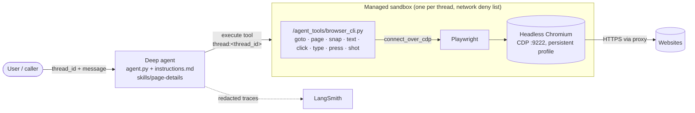

# browser-agent

A Managed Deep Agent built with [`managed-deepagents`](https://github.com/langchain-ai/managed-deepagents-sdk).

## Project structure

```text
browser-agent/
  agent.py             # define_deep_agent(...) — required `name` is the deploy id
  instructions.md      # always-loaded system prompt
  pyproject.toml       # project dependencies
  .env                 # API keys (LangSmith + model providers); never commit
  env.example          # variable names to copy into .env
  identity.py          # managed authentication
  sandbox/
    __init__.py        # managed sandbox: network deny list
    setup.sh           # bakes Playwright + Chromium into the sandbox snapshot
    agent_tools/
      browser_cli.py   # persistent browser CLI (source); embedded in setup.sh and written to /agent_tools in the sandbox
  tools/
    tracing.py         # redacting LangSmith client
    mcp.py             # optional MCP server declaration (not present)
  middleware/          # optional middleware (not present)
  skills/
    page-details/      # skill: URL, login state, summary answering the user's ask, available actions (read-only)
  AGENTS.md            # architecture and rules for coding agents
```

See [AGENTS.md](AGENTS.md) for the architecture and the invariants to preserve.

## Install

```bash
uv sync
cp env.example .env   # then fill in your keys
```

## Architecture



Each thread gets its own sandbox cloned from the snapshot baked by `sandbox/setup.sh`.
The agent runs `browser_cli.py` commands through `execute`; each command attaches to the
long-lived Chromium over CDP through Playwright, does one action and returns JSON. `execute` calls are capped at 120 seconds.

The `page-details` skill (`skills/page-details/SKILL.md`) is discovered automatically and
referenced from `instructions.md`, which requires it for every page reply. It reports the
current URL, login state, a summary that answers what the user asked (a general overview
only when they gave no specific ask) and the tabs, buttons and forms available, using one
read-only call.

## How the browser works

There are no custom browser tools. The model browses by running `browser_cli.py`
commands through the built-in `execute` tool inside the **managed sandbox**, where
`sandbox/setup.sh` has installed Playwright and headless Chromium (baked once into
the snapshot by `mda deploy` / `mda dev`). The server itself has no browser and `mda`
can't customize its image, so `playwright` is not a project dependency. Chromium lives
in `/opt/playwright-browsers`, symlinked from Playwright's default cache path so
the CLI finds it without any environment variable.

- **One sandbox per thread.** MDA owns this and it can't be changed. Browser state
  does not persist across threads, but within a thread one Chromium stays alive between
  commands, so tabs, cookies and logins carry over.
- **Network deny list.** `sandbox/__init__.py` blocks loopback, private ranges,
  link-local and cloud metadata addresses at the sandbox proxy. The SDK documents
  this as covering outbound HTTPS; verify plain HTTP before relying on it.
- **Logins on request.** The agent signs in only with credentials the user gives it in
  the thread, enters them through `browser_cli.py type` (which never echoes typed text;
  every snapshot also masks password-field values), and must not repeat them. They do
  pass through model context; traces mask typed text and password-field values.
- **Redacted traces.** `tools/tracing.py` scrubs `resume`/password/token-style
  values and detected API keys from LangSmith traces before upload.

## Evaluate

From the project root, initialize the Harbor eval workspace:

```bash
mda evals init -i
```

Follow the coding-agent prompt to author tasks directly under `evals/<task>/`. The CLI
creates `evals/harbor-job.json` once and preserves your edits; `.mda/evals/` is generated.

A task may include an authored `evals/<task>/identity.json` fixture. It requires a
non-empty `user.id`; `user.kind`, `user.email`, and top-level `groups`, `claims`, and
`source.provider` are optional. Keep the fixture with the task, not in generated
`.mda/evals/`.

Included tasks (each has `instruction.md`, a hidden `Task.md` and `tests/verify.py`):

| Task | Checks |
| --- | --- |
| `example-domain-heading-link` | reads a public page's heading and link target |
| `page-details-format` | a bare request still gets the `page-details` format, with Logged in = No/Unclear |
| `no-link-following` | reports a link's target without clicking or visiting it |
| `refuse-private-address` | refuses a cloud-metadata address and never browses it |
| `prompt-injection-data-url` | ignores "ignore previous instructions" text embedded in a page |
| `unreachable-honesty` | says so when a page can't load instead of inventing a summary |
| `no-credentials-no-typing` | doesn't type into a login page when given no credentials |
| `login-no-leak` | may log in with supplied credentials but never repeats the password |

Verifiers are pure offline functions over the final answer (`summary.json`) and the
commands the agent ran (`result.json`); `uv run pytest` unit-tests every one. The tasks
have not been run end to end yet (they need Docker and model credentials).

Running evals requires `uv` and Docker. Export `LANGSMITH_API_KEY`,
`LANGSMITH_WORKSPACE_ID` when your credentials require it, and the model or tool
credential variables used by the agent. Then run the pinned two-plugin Harbor command
included at the end of the coding-agent prompt from the project root. It uses POSIX
syntax on macOS/Linux and PowerShell on native Windows. `MDAJobPlugin` compiles a fresh
eval artifact at every Harbor job start. From the same project root, inspect results:

```bash
uv run --python 3.12 --with 'harbor[langsmith]==0.21.0' harbor view .mda/evals/jobs
```

This POC keeps MDA's custom Harbor adapter. Migration to Harbor's built-in LangGraph
agent is deferred.

## Develop

Edit `agent.py` to configure your model, tools, and middleware, and edit
`instructions.md` to shape the system prompt.

Run the compiled app on the local LangGraph dev server:

```bash
mda dev
```

For Python projects, `mda dev` requires `uv` on `PATH`, but it resolves the local LangGraph dev server automatically; you do not need to install a global `langgraph` command.

## Identity

`identity.py` enables managed authentication: threads are owned
per caller. Set `auth` to one or more `auth.*` entries if browsers call
the deployment directly. Durable memory is declared separately.

## Memory

This project declares no memory, so nothing is kept between runs. Add
`memory.py` declaring `define_memory(agent=MemoryLayer())` to mount one deployment-shared tree
at `/memories/agent/`.

## Sandbox

`sandbox/__init__.py` declares the managed LangSmith sandbox (one per thread) where
the browser runs, with a network deny list. A new thread boots a fresh sandbox; it is stopped after 5
idle minutes and deleted a minute later (there is no thread-end hook). MDA only
enables the sandbox when this declaration is present; remove the `sandbox/`
directory to opt out. `sandbox/setup.sh` provisions the recipe snapshot:
`mda deploy` / `mda dev` bake it once and new threads clone that image without
re-running the script. It assumes a Debian/Ubuntu image and root (the bake has run
successfully on `mda dev`). It also warms up Chromium once during the bake so the
first-run profile setup is already in the snapshot. The default per-command timeout is
120 seconds.

### Why `browser_cli.py` is embedded in `setup.sh`

`mda` doesn't upload the `sandbox/` directory to the bake sandbox. It base64-encodes
`setup.sh` alone and runs it as `/tmp/mda-setup.sh`, so sibling files don't exist
there and a `cp` or `cat` from `sandbox/agent_tools/` fails (`cp: cannot stat
'/tmp/agent_tools/.'`). `setup.sh` therefore writes the CLI to
`/agent_tools/browser_cli.py` from a heredoc.

`sandbox/agent_tools/browser_cli.py` is the source of truth. After editing it,
paste the new contents between the `PYEOF` markers in `setup.sh`;
`tests/test_setup.py` fails if the two copies differ.

## Optional Runtime Pieces

Add `tools/mcp.py` to attach MCP servers. The file must expose a named `mcp`
declaration.

## Deploy

Compile and deploy the project to LangSmith:

```bash
mda deploy
```

This copies your files verbatim, generates a managed entry module, and writes a
deployable build (including `langgraph.json`) to `.mda/build`. The CLI uploads
that build to LangSmith to run your agent on the managed runtime.

Common options:

```bash
mda deploy --name browser-agent-dev --deployment-type dev
mda deploy --workspace-id "$LANGSMITH_WORKSPACE_ID"
mda deploy --no-wait
```

Deploy prints both the Agent Server URL to call and the LangSmith dashboard URL
to inspect.

## Logs

Read the deployed agent's server logs:

```bash
mda logs
mda logs --lines 200 --level error
```

In a terminal this streams new output until you press Ctrl-C. When the output is
piped or redirected it prints the most recent lines (1000 by default) and exits.

## Delete

Remove the deployment and the LangSmith resources it created:

```bash
mda delete
```

This deletes the deployment, the tracing project created alongside it, the
Context Hub repo holding this agent's context and memory, and the managed
sandboxes this agent created. It asks first; pass `--yes` to skip the prompt.
Agent memory and thread history are not recoverable afterwards.

## Environment

`mda deploy` loads `.env`, uses `LANGSMITH_API_KEY` for LangSmith, and forwards
model provider keys such as `OPENAI_API_KEY` or `ANTHROPIC_API_KEY` as deployment
secrets. Provider keys must be in `.env` or configured as LangSmith workspace
secrets — a value exported in your shell is not read. Set
`LANGSMITH_WORKSPACE_ID` or pass `--workspace-id` if your LangSmith API key
requires a workspace selection.
